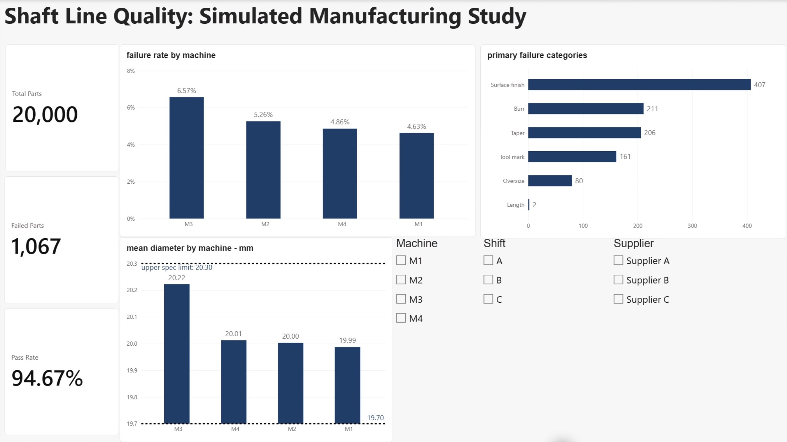

# Shaft Line Quality: Simulated Manufacturing Study

[Download the native report](Shaft%20Line%20Quality.pbix) · [View the screenshot](power_bi_preview.png) · [Source data](../data/manufacturing.csv)

## Open and explore

1. Download `Shaft Line Quality.pbix` and open it in Power BI Desktop on Windows.
2. Start with all slicers cleared. The baseline is 20,000 parts, 1,067 failed parts and a 94.67% pass rate (rounded from 94.665%).
3. Use the Machine, Shift and Supplier slicers to inspect subsets. Clear selections to return to the baseline; displayed totals and rates reflect the active filter context.

The report contains an imported data snapshot. If a refresh asks for the original local CSV, use **Transform data → Data source settings → Change Source** to point to this repository's `data/manufacturing.csv`. No Power BI service publication or scheduled refresh is configured by this repository.

## What the visuals mean

- **Failure rate by machine:** failed inspected parts divided by inspected parts within the selected group.
- **Primary failure categories:** one assigned primary category per failed part, excluding `None`; not a count of all defects or defect opportunities.
- **Mean diameter by machine:** average measured diameter in millimeters. Dashed specification limits at 19.7 and 20.3 mm come from the simulated shaft specification. They are not control limits, and averages within specification do not imply every individual part conforms.

This dashboard supports descriptive exploration of Phase 1. Use the separate [ordered SPC and capability study](../phase2_spc_capability/README.md) for time-ordered stability and conditional capability analysis. The simulation's programmed M3 offset is a teaching assumption, not a discovered factory cause.

## Preview

All observations are simulated. No physical inspection, shop-floor implementation or realized savings are claimed.
