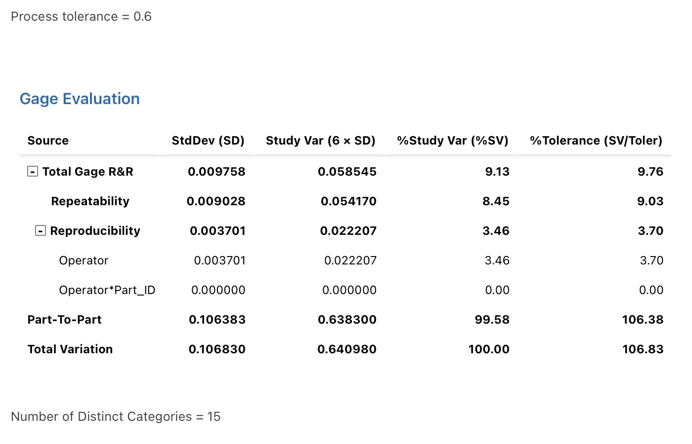
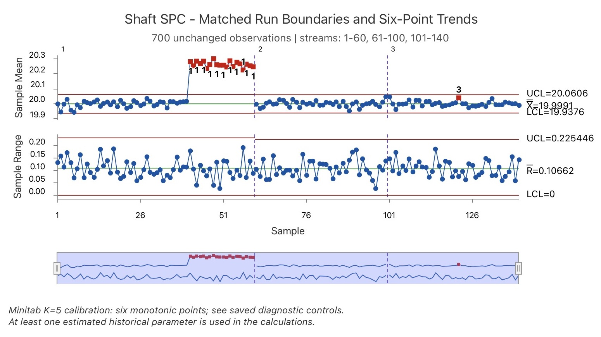

# Minitab reproduction and verification

The three requested analyses were **actually run in Minitab Statistical Software's web app in Safari on macOS on October 17, 2026**. These are reproductions of the earlier Python analyses, not evidence that Minitab was used for the original work. All observations remain simulated; no physical measurement-system validation is claimed.

[Download the complete native Minitab project](outputs/shaft_quality.mpx) · [Full-precision comparison](comparison.csv) · [Native table index](outputs/table_manifest.json) · [Detailed run and discrepancy log](RUN_LOG.md)

## Results

The crossed ANOVA study uses 10 parts, 3 operators and 3 repeats: 90 readings. Minitab returned **9.1337122782% study variation**, **9.7575385053% tolerance** and **15 distinct categories**. The original 9.13% is study variation, not percent variance contribution (0.834247%). The full model was retained for a like-for-like comparison; this is not the default reduced-model analysis.

All 700 observations were imported, preserving 140 subgroups of five. The final chart uses three control streams: groups 1–60 (reference plus shift), 61–100 (rebaseline), and 101–140 (verification), with the original frozen parameters. The original `Phase` column remains unchanged. Minitab detects Test 1 at **41–60**, Test 2 at **43–60**, and Test 3 at **122**. These are exact alarm-location matches to the reference, verified in [alarm_comparison.csv](outputs/alarm_comparison.csv). The R chart has no displayed alarms. Separate reference/rebaseline estimation and verification diagnostic runs are retained in the native project.

**The initial discrepancy was resolved by calibration, not by editing measurements.** In this web-app session, K=6 first flagged the seventh point of an increasing diagnostic sequence. K=5 flagged the sixth point in both increasing and decreasing six-point controls; ties, reversals and five valid points did not signal. The final chart therefore uses **Test 3 K=5 as an empirically verified six-point rule**, even though Minitab's generated label says “5 points.” The label/settings difference is deliberately disclosed; do not present this as unmodified default Minitab behavior or a universal claim about other releases. Matching the reference/shift run boundary also reconciled Test 2. See the [calibration evidence](RUN_LOG.md#resolution--calibrated-rule-and-matched-streams). Verification remains provisional because its trend is confirmed.

| Phase | Cp | Cpk | Pp | Ppk | Interpretation |
|---|---:|---:|---:|---:|---|
| Reference, 200 readings | 2.122 | 2.115 | 2.127 | 2.121 | Conditional on assumptions; no selected-rule alarms in this window |
| Rebaseline, 200 readings | 2.182 | 2.175 | 2.226 | 2.220 | Conditional on assumptions; no selected-rule alarms in this window |
| Setup shift, 100 readings | 2.284 | 0.270 | 2.265 | 0.268 | Descriptive only; unstable against the baseline |
| Verification, 200 readings | 2.163 | 2.161 | 2.287 | 2.286 | Provisional; trend confirmed in both tools |

Minitab's saved full-precision capability values match the earlier calculations within the specified tolerances. The capability analysis was split by Phase, never pooled across the shift. These indices do not prove long-term stability or realized production improvement.

## Evidence and provenance

- `outputs/shaft_quality.mpx`: unmodified native download containing both worksheets, all analyses, calibration controls, stored chart statistics and command history. Diagnostic columns are not production measurements.
- `outputs/gage_rr.mpx`: earlier Gage R&R-only checkpoint.
- `outputs/*_commands.txt`: Minitab-generated execution history, extracted from the native project.
- `outputs/*_table_*.csv`: full-precision result tables extracted from the native project; missing numeric sentinels are exported as empty cells.
- `outputs/*.jpg`: genuine application captures, cropped only to remove browser chrome and unrelated tabs. They are not charts regenerated in Python.
- `outputs/staged_xbar_r_corrected.jpg`: final chart; the earlier `staged_xbar_r.jpg` and `verification_chart.jpg` are retained only as superseded diagnostic evidence.
- `outputs/control_chart_statistics.csv`: native stored means, ranges, centers and limits for all 140 subgroups. The small R-UCL difference from the reference is documented constant precision, not a matching-alarm failure.
- `extract_native_results.rb`: extracts saved tables and compares values; it does **not** compute GR&R, control charts or capability statistics. No Python analysis was rerun for this reproduction.

The web app's About dialog did not expose a numeric version; execution timestamps and generated command specifications are preserved in the native project and table manifest.

## Prepared inputs and comparison protocol

Import the CSVs in `inputs/` via the application worksheet open/import command. These are synthetic data. Preserve columns and subgroup order. `python_reference.csv` is the pre-existing Python reference; `comparison.csv` contains actual Minitab GR&R, capability and stored chart-limit values. Supplied historical parameters are labeled as such, not claimed as independent estimation checks. The optional one-way ANOVA was outside this three-analysis request and was not run.

| Analysis | Input | Required options | Compare / save |
|---|---|---|---|
| Crossed Gage R&R | gage_rr.csv | Parts=Part_ID, operators=Operator, measurement=Diameter_mm; ANOVA; 6 sigma; tolerance width 0.6; retain part/operator interaction | Variance components, GR&R SD, study variation %, tolerance %, ndc; native project + exported output |
| X-bar/R | all 700 rows in ../phase2_spc_capability/spc_data.csv | Diameter_mm grouped by Subgroup, n=5; streams 1–60/61–100/101–140; frozen means/SDs; Tests 1/2/3, K=3/9/5 with six-point calibration disclosed | Exact alarm lists; stored centers/limits; no verification re-estimation; interpret R Test 1 |
| Normal capability | each phase CSV separately | LSL19.7, USL20.3; subgroup5; within SD Rbar/d2, 6 sigma; no transformation | mean, within/overall SD, Cp/Cpk/Pp/Ppk; label verification provisional and shift descriptive |
| One-way ANOVA | anova.csv | Response Diameter_mm, factor Machine; equal-variance model for numerical comparison | F, DF, p; phase1 unequal variances/large n limit causal interpretation |

The Python GR&R retains interaction even when a term is small; Minitab can remove a nonsignificant interaction by default. Match that choice explicitly before comparing. Truncated negative components, ndc rounding, d2 precision and displayed decimal rounding must be logged. Suggested comparison tolerances: means/SD/limits 1e-5 mm, capability indices 0.002, variance components 1e-7 mm^2; compare underlying precision rather than rounded screenshots. A mismatch must be investigated, not overwritten.

The saved project records the settings that were actually executed. Minitab experience can now be described as a software reproduction of a simulated study with calibrated, matching X-bar alarm lists and matching GR&R/capability results. Do not claim default-setting equivalence, identical rounded R constants, shop-floor measurements, or closed corrective-action effectiveness.

Official procedures: [crossed GR&R](https://support.minitab.com/en-us/minitab/help-and-how-to/quality-and-process-improvement/measurement-system-analysis/supporting-topics/basics/measurement-system-analyses-in-minitab/) and [X-bar/R overview](https://support.minitab.com/en-us/minitab/help-and-how-to/quality-and-process-improvement/control-charts/how-to/variables-charts-for-subgroups/xbar-r-chart/before-you-start/overview/).
